# Rondo

**A click-wheel firmware for the Innioasis Y1: the music on your card, audiobooks, podcasts,
YouTube Music, YouTube, WhatsApp and FM radio, all from the wheel.**

<p align="center">
  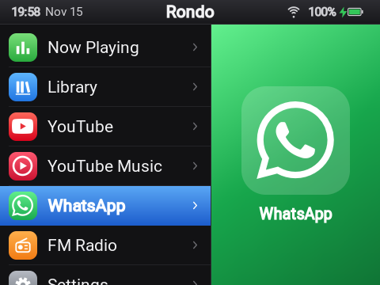
  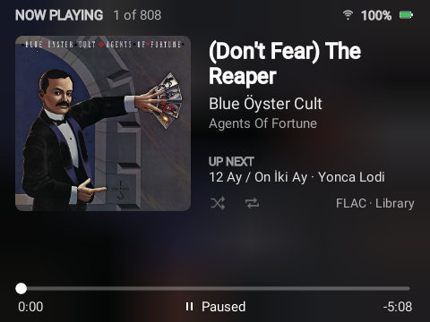
</p>

<p align="center">
  <a href="docs/install.md"><b>Install</b></a> ·
  <a href="docs/using.md"><b>Use</b></a> ·
  <a href="docs/dashboard.md"><b>Dashboard</b></a> ·
  <a href="docs/server.md"><b>Server</b></a> ·
  <a href="docs/troubleshooting.md"><b>Help</b></a> ·
  <a href="CHANGELOG.md"><b>What's new</b></a>
</p>

The Innioasis Y1 is a small music player with an iPod-style click wheel. Underneath, it runs
Android 4.2. Rondo is a firmware for it, built from the community's Android 4.2 base with
Android's whole app layer taken out: the Y1 starts straight into Rondo, a program of its own that
draws every screen itself, 60 times a second, with menus made for the wheel. Play the music and
audiobooks on your microSD card, follow podcasts, stream YouTube Music and YouTube straight from
the Y1, read and send WhatsApp messages through a server of your own, and listen to FM radio, all
without a touchscreen. You install it with Innioasis Updater CE, the same way as Rockbox or the
Y1's original software, and you can always go back.

## What it does

### Your music, from the card

Copy music onto the microSD card and Rondo sorts it by song, artist, album artist, album and
genre, using the files' tags. You get covers, Cover Flow, lyrics that scroll along with the song,
search as you type, ratings, and playlists you make on the Y1 or in your browser, including smart
playlists that pick their songs by rules, plus Recently added, Most played, Recently played and Top
rated. A sleep timer fades the music out after 15 to 60 minutes or at the end of the song, and after
a restart the queue comes back where you left it. Library also has the videos and photos on the card, and
a file manager. **Organize the card** puts everything in the folders Jellyfin, Plex and Kodi
expect, after showing you every move, and the dashboard looks up a show's or a movie's years and
fills in a song's missing genre, year and lyrics. Plug the Y1 into a computer and choose **Use as
USB drive** to reach the card from it.

<table>
  <tr>
    <td align="center">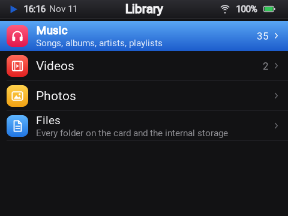<br>The library</td>
    <td align="center">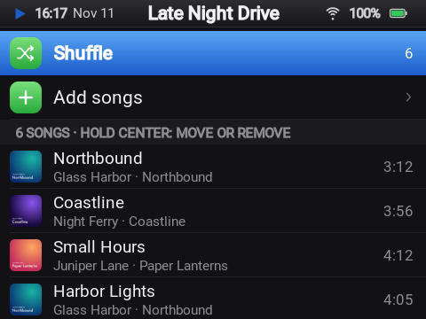<br>A playlist</td>
    <td align="center">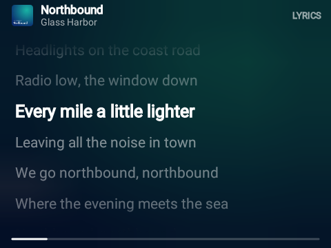<br>Lyrics that follow the song</td>
  </tr>
  <tr>
    <td align="center">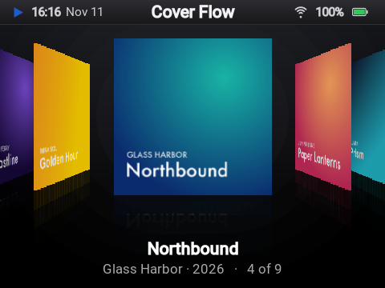<br>Cover Flow</td>
    <td align="center">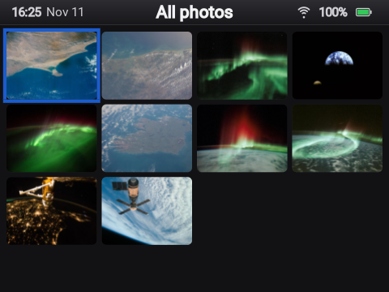<br>Photos</td>
    <td align="center">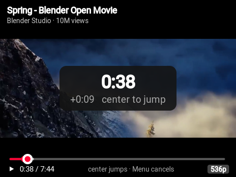<br>Videos</td>
  </tr>
</table>

Every common music format: MP3, AAC/M4A, ALAC, FLAC, Ogg, Opus, WAV, AIFF, WMA, APE, WavPack,
AC-3, DTS, DSD and more. Lyrics come from the file's tags or an `.lrc` file next to it, and videos
show the subtitle files beside them. Nothing on the card ever needs the internet.

### Audiobooks and podcasts

**Audiobooks** have a place of their own in Library, as on the stock firmware but further: each
book remembers where you stopped, Next and Previous move by chapter, the speed goes from 0.75× to
3× with the voice's pitch kept, and there are bookmarks and a sleep timer. Your music waits while a
book plays, and comes back after.

**Podcasts**, on the main menu, follow any show with a public feed, the way podcast apps do: search
Apple's directory (and Podcast Index's too, with a free key), browse Apple's top charts for your country, subscribe, and
the Y1 looks for new episodes by itself. Episodes play like books: each keeps its place, Next and
Previous move by its chapters, and every show keeps its own speed. Video episodes play as video.
Download an episode to the card, or let a show keep its latest ones there over Wi-Fi. On the
dashboard, add a private or paid show by its feed address, or bring your shows from another podcast
app with an OPML file. No server needed: the Y1 reads each feed and plays each episode straight from
the podcast's own host.

**YouTube Music's podcasts** are in its Podcasts tab, with the same care: search for shows and
episodes, and, signed in with a cookies.txt, your saved shows, Episodes for Later and new episodes.
YouTube's chapters, downloads, and played marks shared with YouTube Music on your phone come along.

### YouTube Music and YouTube

Straight from the Y1 over Wi-Fi, with nothing to set up: home, search, artists, albums,
playlists, up next, a radio from any song, lyrics, Shorts, and video up to 720p with subtitles in the
look you choose. Sign in with a code, the way you'd sign in a smart TV, for YouTube's home for you,
your subscriptions and history, and your YouTube Music playlists and Liked Music (a cookies.txt
adds YouTube Music's own home and history), or use it without an account. YouTube's own words come
in your language.

**Download** to the card, to play with no connection: songs, whole albums and playlists from
YouTube Music (tagged AAC files with their covers and lyrics; a downloaded playlist shows in Library
and can be brought up to date), videos at the quality you pick with their subtitles, and podcast
episodes. Downloads pause and resume, carry on after a restart, and wait by themselves while Wi-Fi
is off, or the card is full or on a computer. If you'd rather
the Y1 never talked to YouTube itself, a [Rondo server](#your-own-server-optional) of your own
can do that part instead.

<table>
  <tr>
    <td align="center">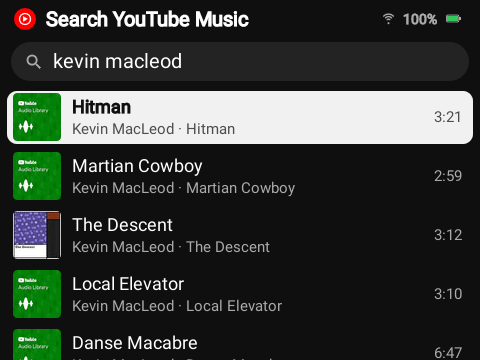<br>Searching YouTube Music</td>
    <td align="center">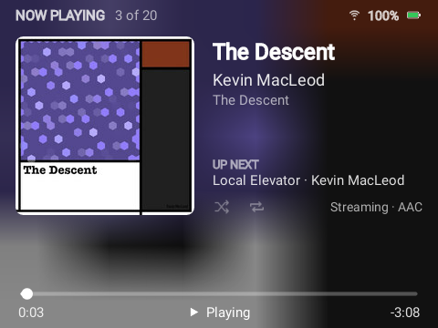<br>Streaming a song</td>
  </tr>
  <tr>
    <td align="center">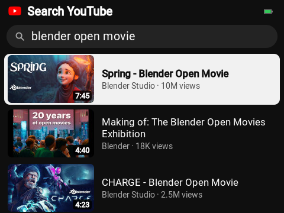<br>Searching YouTube</td>
    <td align="center"><br>A video with subtitles</td>
  </tr>
</table>

Streams play as they arrive. Nothing from YouTube is stored, except what you choose to download.

### WhatsApp (with your own server)

Your chats and groups on the Y1: read them, search them by name or number, answer them (with
emoji too), react to messages, send voice messages recorded with the Y1's built-in microphone, and
send photos and videos from the card. Photos and videos you receive
open full screen, voice messages play in place of the music (which comes back after), and every
contact has their picture, number and about. It works through your
[Rondo server](#your-own-server-optional), which becomes one of your WhatsApp's linked devices,
like WhatsApp Web: you link it once on the server's admin page, with a code you type on your
phone.

<table>
  <tr>
    <td align="center">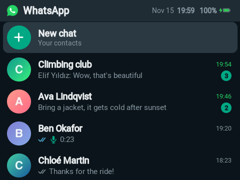<br>Your chats</td>
    <td align="center">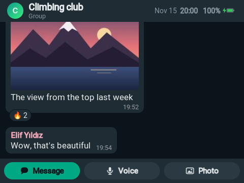<br>A group chat</td>
    <td align="center">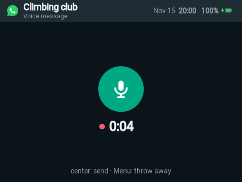<br>A voice message</td>
  </tr>
</table>

The Y1 shows no notifications: what came is there when you open WhatsApp, and a chat you open is
marked read. The server never shows you as online, so your phone keeps its own notifications. The
Y1 keeps your recent chats, and the photos, videos and voice messages you opened, on the card (up
to 1 GB), so they open at once and without a connection.

### Made for the wheel

Every screen works with the wheel and five buttons. Each wheel pulse is one step, like Rockbox,
with an optional buzz and click on every step and acceleration for long lists. Screens slide in
and out like an iPod's, and lists glide. With the screen off, a press only wakes it, so nothing
skips in your pocket. Searches, messages, Wi-Fi passwords and playlist names are typed on a
keyboard you move through with the wheel or the buttons, with every emoji in tabs, skin tones and
search by name (and Apple's emoji, if you make them on your own Mac). Rondo speaks English and
Spanish: it asks on its first start, and Settings › Language changes it at once, the dashboard
included. Choose a light or dark look, an
accent color and a text size, and which entries the main menu shows, in which order.

<table>
  <tr>
    <td align="center">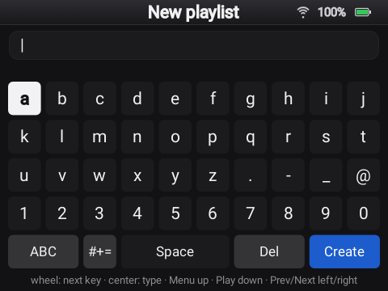<br>The wheel keyboard</td>
    <td align="center">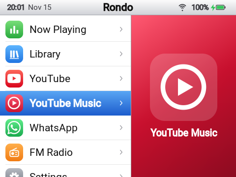<br>The light look</td>
    <td align="center">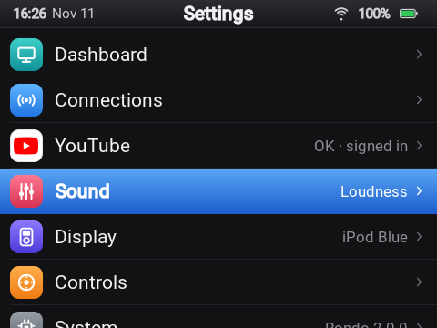<br>Settings</td>
  </tr>
</table>

### Sound

An equalizer with presets or ten bands of your own, kept for each output: the speaker, wired
headphones and each Bluetooth device. A loudness boost whose peaks never clip, volume leveling,
the Y1's amplifier up to 6 dB louder, and a volume limit. With a server, **Headphone match**
corrects the sound for your headphone model.

<p align="center">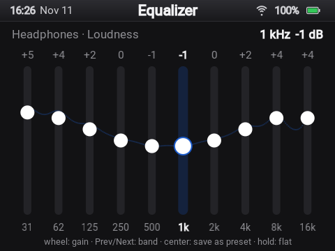</p>

### FM radio, Bluetooth and Wi-Fi

The Y1's FM radio, with station names, a scan of the whole band, saved stations and a speaker
option; wired headphones are the antenna. Bluetooth headphones and speakers, and Wi-Fi networks,
are set up from the wheel as well. A wired headset's buttons work too.

### A dashboard in your browser

Open **Settings › Dashboard** on the Y1, then the address it shows on your phone or computer.
From there you can upload music, videos, photos and audiobooks, manage the files on the card, make
playlists and smart playlists, follow podcasts (and import or export them as OPML), control what's
playing, change the theme, the sound and every
other setting, download a video, a song or a playlist from its YouTube link, set the sleep timer,
manage Wi-Fi, Bluetooth, YouTube and the radio, and shut down, restart or update
the Y1. It runs on the Y1 itself, over your Wi-Fi.

<p align="center">
  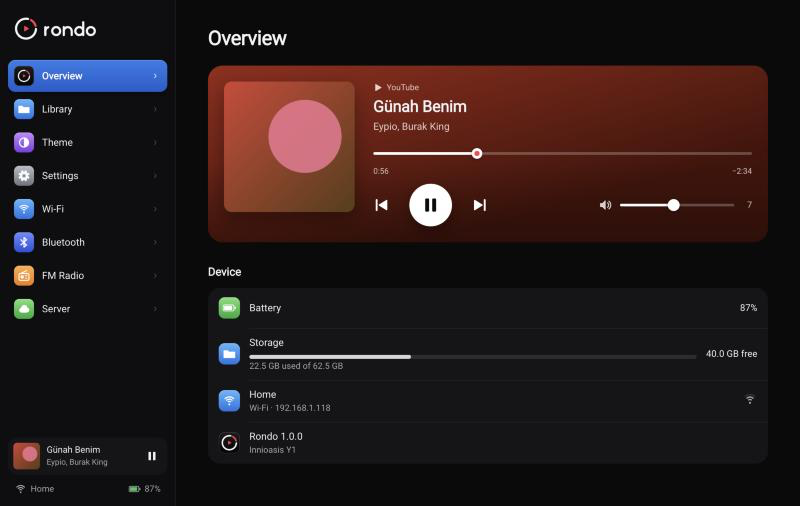
  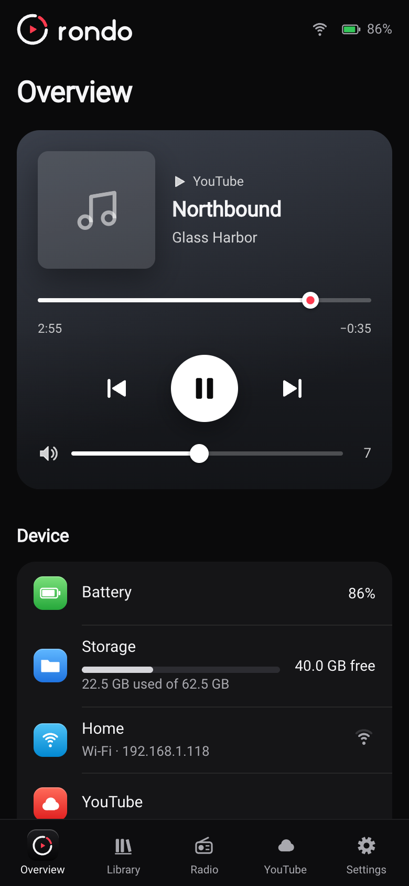
</p>

### Updates that keep everything

A new Rondo installs in about a minute, without reinstalling the firmware: from **Settings ›
System › Software update** over Wi-Fi (straight from GitHub, no server needed), with **Install**
in the dashboard, or over USB from [the update page](https://jarvissax.github.io/rondo/). Your
settings, Wi-Fi, playlists and music stay as they are. The rare release that changes the
firmware itself says so, and installs with Innioasis Updater CE instead.

## What you need

- An **Innioasis Y1, Type A**: one that shipped with Innioasis's own software 2.0.0 or later. Not
  sure which type yours is? See [Before you start](docs/install.md#before-you-start).
- A **computer** (macOS, Windows or Linux) with **Innioasis Updater CE**, and a USB-C cable that
  carries data, for the install.
- **2.4 GHz Wi-Fi** for YouTube, podcasts, WhatsApp, updates and the dashboard. The Y1 can't see 5 GHz networks.
- Optional: a **[Rondo server](docs/server.md)** of your own, on a computer at home that stays on
  (a 64-bit Raspberry Pi or a NAS is fine) or a small VPS. YouTube works without it; WhatsApp
  needs it.

## Getting started

1. **[Install Rondo](docs/install.md)** with Innioasis Updater CE: choose the Y1, Type A, then
   Rondo. It takes about 10 minutes, and your microSD card isn't touched.
2. **[First start](docs/install.md#first-start):** pick your language, join Wi-Fi, copy your music onto the card, and
   look through Settings. YouTube Music and YouTube work as soon as the Y1 is online.
3. **Sign in to YouTube** if you like: **Settings › YouTube › YouTube account** shows a code to
   enter at google.com/device.
4. **[Learn the controls](docs/using.md)**, and open the **[dashboard](docs/dashboard.md)** on
   your phone.

### The controls at a glance

| Control | What it does |
| --- | --- |
| **Wheel** | Moves through lists. On Now Playing, a video or the radio, it changes the volume. |
| **Center** | Opens or selects. **Hold** it for options. |
| **Menu** (top) | Back. |
| **Play/Pause** (bottom) | Plays and pauses, from any screen. |
| **Next / Previous** | Next or previous song (in a book or an episode, its next or previous chapter). **Hold** to fast-forward or rewind. |
| **Hold center on the main menu** | Turns the Y1 off after 2 seconds. Restart is in Settings › System › Shut down. |

[Using Rondo](docs/using.md) has the details for every screen, and every setting.

## Your own server (optional)

<p align="center">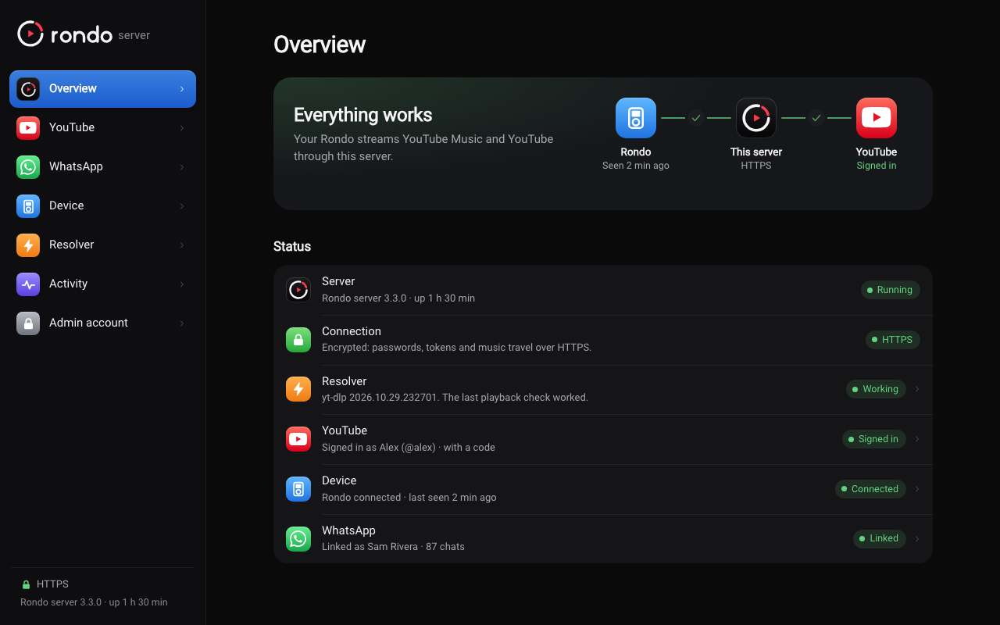</p>

You don't need a server for YouTube or podcasts: Rondo talks to YouTube and reads podcast feeds
itself. A Rondo server does more for those who'd like one:

- **WhatsApp.** The server is your WhatsApp's linked device and keeps your chats, photos, videos
  and voice messages for the Y1. You link it on its admin page.
- **YouTube without the Y1 talking to Google**, if you choose it in **Settings › YouTube ›
  Connect to**: the server browses YouTube for the Y1, finds the streams with yt-dlp (which keeps
  up with YouTube's changes and updates itself every day) and passes them on, with its own
  YouTube account signed in on its admin page.
- **Headphone match**, the sound corrected for your headphone model.
- **Podcast Index** in podcast search, with the free key you paste on its admin page (a Y1 without
  a server can take one on its dashboard), and big podcast feeds read for the Y1 a page at a time.

You run it with Docker at home or on a VPS, set it up from its admin page in the browser and
connect your Y1 with a six-digit code in **Settings › Server**; a new version installs with one
click there. One server serves one Y1. See [Setting up a Rondo server](docs/server.md).

## How it works

```
 Innioasis Y1                  directly                         YouTube
┌───────────────┐  Wi-Fi  ──────────────────────────────────▶ ┌──────────┐
│ Rondo         │                                             │          │
│ music on SD   │         or through   ┌───────────────────┐  │          │
│ FM, Bluetooth │  Wi-Fi  ───────────▶ │ your Rondo server │─▶│          │
└───────────────┘                      │ (Node, yt-dlp,    │  └──────────┘
        │                              │  Baileys)         │─▶┌──────────┐
        │ Wi-Fi, directly              └───────────────────┘  │ WhatsApp │
        ▼                                                     └──────────┘
 podcasts' own hosts,
 Apple's podcast directory
```

Rondo has its own YouTube client built in: it browses YouTube Music and YouTube the way their
apps do and plays the streams as they arrive. With **Settings › YouTube › Connect to › Through my
server**, the Y1 talks only to your server instead, which browses YouTube with
[youtubei.js](https://github.com/LuanRT/YouTube.js), finds the streams with
[yt-dlp](https://github.com/yt-dlp/yt-dlp) and passes audio and video through to the Y1 in a form
it can play. WhatsApp always goes through the server, which is one of your WhatsApp's linked
devices thanks to [Baileys](https://github.com/WhiskeySockets/Baileys) and passes the Y1 your
chats, contacts and media, and sends what you write or record.

Podcasts need neither: the Y1 finds shows in Apple's podcast directory (and Podcast Index's), reads
each show's RSS feed and plays its episodes straight from the podcast's own host, as podcast apps
do.

## The project

| Folder | What's in it |
| --- | --- |
| `native/` | Rondo itself: the program the firmware runs (C++ with the NDK, its own GLES2 UI, FFmpeg), with its YouTube client in `native/direct/` and the dashboard's page in `native/assets/dashboard/` |
| `firmware/` | The script that builds the firmware (`rom.zip`) from the community's base ROM, and Rondo's start script |
| `server/` | The optional Rondo server (Node 22, TypeScript, Fastify) |
| `infra/` | Docker and Caddy files for running the server |
| `web-updater/` | The update page (WebUSB), published on GitHub Pages |
| `tools/` | The native build and bundle scripts, mock servers for UI work, the boot screen generator, the version script |
| `lang/` | Every text Rondo shows, one file per language ([Translating Rondo](docs/translating.md)) |
| `docs/` | Guides, plus [notes on the Y1's internals](docs/device/README.md) and [API references](docs/dev/) |

Every release is built the same way: the signed Rondo bundle goes up, and GitHub Actions builds
the firmware from it and publishes the update page. To build it yourself, start with
**[Building Rondo](docs/building.md)**.

## Feedback and contributing

If you try Rondo on your Y1, I'd love to hear how it went, good or bad.

- **[Report a problem](https://github.com/jarvissax/rondo/issues/new?template=bug_report.yml)**
  if something doesn't work.
- **[Share an idea](https://github.com/jarvissax/rondo/issues/new?template=idea.yml)** for
  something you'd like Rondo to do.
- **[CONTRIBUTING.md](CONTRIBUTING.md)** says what feedback helps most, how to get Rondo's log,
  and how to work on the code.
- **[Translating Rondo](docs/translating.md)**: Rondo speaks English and Spanish, one file per
  language in `lang/`. Fixing a translation or adding a language needs no Y1 and no build.

## Thanks

Rondo stands on other people's work:

- The **[y1-community](https://github.com/y1-community)**: its
  [Innioasis Updater CE](https://github.com/y1-community/Innioasis-Updater), which installs Rondo,
  and its [Android 4.2 base ROM](https://github.com/y1-community/y1-ata-rom), with the Y1's
  Wi-Fi switched on, which Rondo's firmware is built from.
- **[Rockbox's Y1 port](https://github.com/multiwirth/rockbox-y1)**, whose wheel handling Rondo
  copies, and the **[JJ Launcher](https://github.com/ismileblue/y1_launcher)** and
  **[Inniclassic](https://github.com/FabianZettl/inniclassic)** launchers, which showed how the
  Y1's buttons behave.
- On the Y1: **FFmpeg**, **curl**, **OpenSSL**, **FreeType**, **HarfBuzz**, **SQLite**,
  **libpng**, **libjpeg-turbo**, **yyjson**, **nghttp2**, **Sonic**, and the **Roboto** and **Noto Color
  Emoji** fonts. On the server: **youtubei.js**, **yt-dlp**, **Baileys**, **Fastify** and **sharp**.
  **[AutoEq](https://github.com/jaakkopasanen/AutoEq)**'s measurements are behind Headphone match,
  **[LRCLIB](https://lrclib.net)** has many of the lyrics, and Apple's podcast directory and
  **[Podcast Index](https://podcastindex.org)** find the podcasts. See
  [THIRD_PARTY_NOTICES.md](THIRD_PARTY_NOTICES.md).

## License and fine print

Rondo is released under the [MIT License](LICENSE).

Rondo is an independent project. It isn't affiliated with or endorsed by Innioasis, Google,
YouTube, WhatsApp or Meta. YouTube and YouTube Music are trademarks of Google LLC; WhatsApp is a
trademark of WhatsApp LLC. Rondo reaches YouTube the same way other unofficial clients do, which
YouTube's terms don't allow and which YouTube can break at any time. Its WhatsApp is an unofficial
linked device too: WhatsApp's terms don't allow it, and WhatsApp may close accounts that use one.
Use your own accounts, and use them at your own risk. The pictures show openly licensed
media (Kevin MacLeod's music, Blender's open movies and public-domain photos), synthetic test
albums, and made-up people and chats made for the screenshots.
