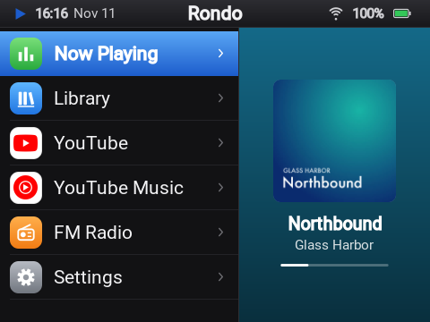
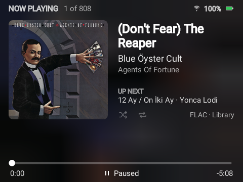

# Rondo

**A click-wheel firmware for the Innioasis Y1, with your music, YouTube Music, YouTube and FM radio.**

<p align="center">
  
  
</p>

The Innioasis Y1 is a small music player with an iPod-style click wheel. Underneath, it runs
Android 4.2. Rondo is a firmware for it, built from the community's Android 4.2 base: everything
else is taken out, and the Y1 starts straight into menus made for the wheel. You can play the
music on your microSD card, stream YouTube Music and YouTube, and listen to FM radio, all without
a touchscreen.

## What it does

- **Your music on the card.** FLAC, MP3, M4A, AAC, OGG, Opus and WAV, by song, artist and album,
  with covers, lyrics (from the file's tags or an `.lrc` file next to it), search and playlists.
  Videos on the card play too. Plug the Y1 into a computer and the card becomes a USB drive.
- **YouTube Music and YouTube**, streamed live through a small server you run yourself. You get
  home, search, artists, albums, playlists, lyrics, Shorts and video up to 720p. Sign in for your
  own library, subscriptions and history, or use it without an account.
- **FM radio**, with station names, scanning, saved stations and a speaker option. Your wired
  headphones are the antenna.
- **Bluetooth** headphones and speakers, and **Wi-Fi**, both set up from the wheel.
- **A dashboard in your phone's browser** while the Y1 shows it: upload music, make playlists,
  control playback, change the theme and settings, manage Wi-Fi, Bluetooth and the radio.
- **A wheel that feels right.** One step per wheel pulse like Rockbox, optional vibration and a
  click on every step, and acceleration for long lists.
- **Easy updates.** A new Rondo installs over Wi-Fi from the Y1 or its dashboard, or over USB from
  a web page, in a minute and with everything kept. No reflashing.
- **Nothing is downloaded.** Streams play as they arrive; the Y1 and the server never store
  audio or video from YouTube.

## What you need

- An **Innioasis Y1, Type A** (one that shipped with software 2.0.0 or later). Not sure which type
  yours is? See [Before you start](docs/install.md#before-you-start).
- A **computer** (macOS, Windows or Linux) with **Innioasis Updater CE**, and a USB-C data cable,
  for the install.
- For YouTube Music and YouTube: a **Rondo server**. That's a computer at home that stays on
  (a 64-bit Raspberry Pi or a NAS is fine), or a small VPS. Your music card and the FM radio work without it.
- **2.4 GHz Wi-Fi.** The Y1 can't see 5 GHz networks.

## Getting started

1. **[Install Rondo](docs/install.md)** with Innioasis Updater CE: choose the Y1, Type A, then
   Rondo. About 10 minutes. Your microSD card isn't touched.
2. **[Set up a server](docs/server.md)** if you want YouTube Music and YouTube. About 15 minutes
   with Docker.
3. **[Learn the controls](docs/using.md)**: what the wheel and each button do on each screen.

Something not working? See **[Troubleshooting](docs/troubleshooting.md)**, or
[open an issue](https://github.com/jarvissax/rondo/issues/new?template=bug_report.yml).

## How it works

```
 Innioasis Y1                 your Rondo server                YouTube
┌──────────────┐   Wi-Fi    ┌───────────────────┐   internet  ┌─────────┐
│ Rondo        │ ─────────▶ │ browse + stream   │ ──────────▶ │         │
│ music on SD  │ ◀───────── │ (Node, yt-dlp)    │ ◀────────── │         │
│ FM, Bluetooth│   audio,   └───────────────────┘             └─────────┘
└──────────────┘   video
```

The Y1 is too old to talk to YouTube directly: Android 4.2 can't handle today's YouTube
pages, video formats or encryption. So the server does that part. It browses YouTube for the Y1
with [youtubei.js](https://github.com/LuanRT/YouTube.js), finds the streams with
[yt-dlp](https://github.com/yt-dlp/yt-dlp), and passes audio and video through to the Y1 in a
form it can play. The Y1 only ever talks to your server, and one server serves one Y1.

## The project

| Folder | What's in it |
| --- | --- |
| `app/` | Rondo itself, the Android app at the heart of the firmware (Kotlin, classic Views, ExoPlayer 2) |
| `firmware/` | The script that builds the firmware (`rom.zip`) from the community's base ROM |
| `server/` | The Rondo server (Node 22, TypeScript, Fastify) |
| `infra/` | Docker and Caddy files for running the server |
| `web-updater/` | The update page (WebUSB), published on GitHub Pages |
| `tools/` | Mock servers for UI work, the boot screen generator |
| `docs/` | Guides, plus [notes on the Y1's internals](docs/device/README.md) and [API references](docs/dev/) |

To build it yourself, start with **[Building Rondo](docs/building.md)**.

## Feedback and contributing

If you try Rondo on your Y1, I'd love to hear how it went, good or bad.

- **[Report a problem](https://github.com/jarvissax/rondo/issues/new?template=bug_report.yml)**
  if something doesn't work.
- **[Share an idea](https://github.com/jarvissax/rondo/issues/new?template=idea.yml)** for
  something you'd like Rondo to do.
- **[CONTRIBUTING.md](CONTRIBUTING.md)** says what feedback helps most, how to get Rondo's log,
  and how to work on the code.

## Thanks

Rondo stands on other people's work:

- The **[y1-community](https://github.com/y1-community)**: its
  [Innioasis Updater CE](https://github.com/y1-community/Innioasis-Updater), which installs Rondo,
  and its [Android 4.2 base ROM](https://github.com/y1-community/y1-ata-rom), with the Y1's
  Wi-Fi switched on, which Rondo's firmware is built from.
- **[Rockbox's Y1 port](https://github.com/multiwirth/rockbox-y1)**, whose wheel handling Rondo
  copies, and the **[JJ Launcher](https://github.com/ismileblue/y1_launcher)** and
  **[Inniclassic](https://github.com/FabianZettl/inniclassic)** launchers, which showed how the
  Y1's buttons behave.
- **youtubei.js**, **yt-dlp**, **ExoPlayer**, **OkHttp**, **NanoHTTPD**, **ZXing**, **Fastify**,
  **sharp** and the **Roboto** font. See [THIRD_PARTY_NOTICES.md](THIRD_PARTY_NOTICES.md).

## License and fine print

Rondo is released under the [MIT License](LICENSE).

Rondo is an independent project. It isn't affiliated with or endorsed by Innioasis, Google or
YouTube. YouTube and YouTube Music are trademarks of Google LLC. Rondo reaches YouTube the same way
other unofficial clients do, which YouTube's terms don't allow and which YouTube can break at
any time. Use your own account, and use it at your own risk.
