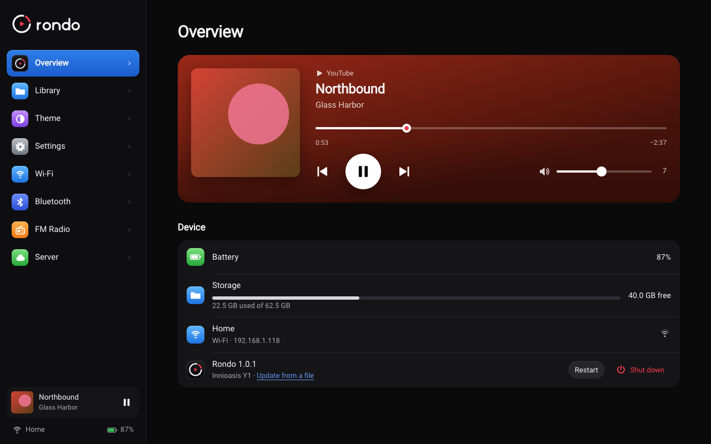

# The dashboard

The dashboard is a web page served by the Y1 itself. Use it from a phone or computer to upload
music, change settings and look after the Y1 without turning the wheel through every menu. It
needs no internet and no server, only the same Wi-Fi as the Y1.

## Opening it

1. On the Y1, open **Settings › Dashboard**. It shows an address like `http://192.168.1.118:8080`,
   a QR code of it, and a 6-digit pairing code.
2. Open that address in a browser on the same Wi-Fi, or scan the QR code with your phone.
3. Type the pairing code.

The dashboard runs only while that screen is open on the Y1. Press Menu on the Y1 to stop it.
The pairing code changes every time. If someone types five wrong codes, the dashboard pauses
pairing for half a minute.

## Overview

What's playing, with play/pause, skip and a volume slider, plus the battery, how full the card
is, the Wi-Fi network and Rondo's version.

## Library

Everything on the card, as songs or videos, with search and sorting by title, artist, album or
date added.

- **Upload** music or videos straight onto the card, several at a time. Expect about 3 MB a
  second over the Y1's Wi-Fi.
- **Play** a song on the Y1, or **delete** it.
- **Rescan** after copying files onto the card some other way.

## Theme

The Y1 redraws while you change things here.

- **Accent:** the color of the selection bar, from a few presets or any color you pick.
- **Appearance:** light or dark menus.
- **Text size:** small, medium or large.
- **Main menu:** show, hide and reorder the entries. Settings is always there.

## Settings

The same settings as on the Y1 (see [Using Rondo](using.md#settings)): video quality,
brightness, screen timeout, lyrics, wheel acceleration, wheel vibration and the click sound.

## Wi-Fi

The network the Y1 is on, your saved networks and the ones nearby. Join a network with its
password, forget one, or refresh the list. Typing a password here is much quicker than on the
wheel.

## Bluetooth

Turn Bluetooth on or off, search for headphones and speakers, pair and connect them, and forget
devices you no longer use. Put the headphones in pairing mode before you search.

## FM Radio

What the radio is playing, with the station name and signal strength, and controls to tune,
seek up and down, scan the whole band, change the volume, mute, and switch between headphones
and the speaker. You can also name, reorder and delete saved stations, save the ones a scan
found, and set the region. Wired headphones must be plugged into the Y1, because they're the
antenna.

## Server

Which [Rondo server](server.md) the Y1 uses, and whether it's reachable.

- **Connect to a server:** enter the server's address and the code from its admin page
  (**Device › Connect a Rondo**), then press **Connect**.
- **Connection test:** the Y1 calls the server and reports how long it took, whether yt-dlp is
  ready and whether an account is connected.
- **Use a token instead:** only for servers started with an `API_TOKEN` setting. Servers set up
  as in the server guide don't need it.

## For developers

The dashboard's API is documented in [docs/dev/dashboard-api.md](dev/dashboard-api.md). To work
on the page without a Y1, run the mock in `tools/dashboard-mock` (see
[Building Rondo](building.md#working-on-the-dashboard-or-admin-page)).
