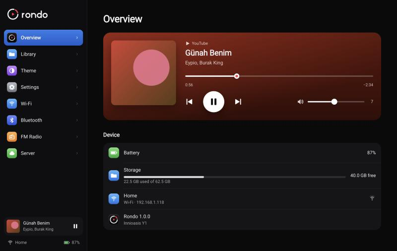
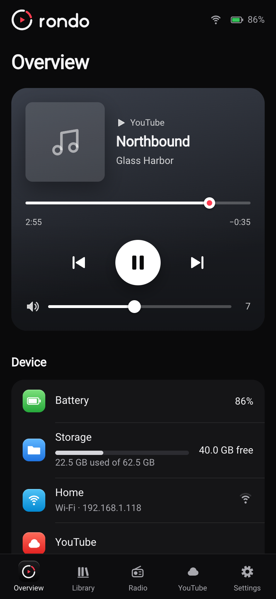
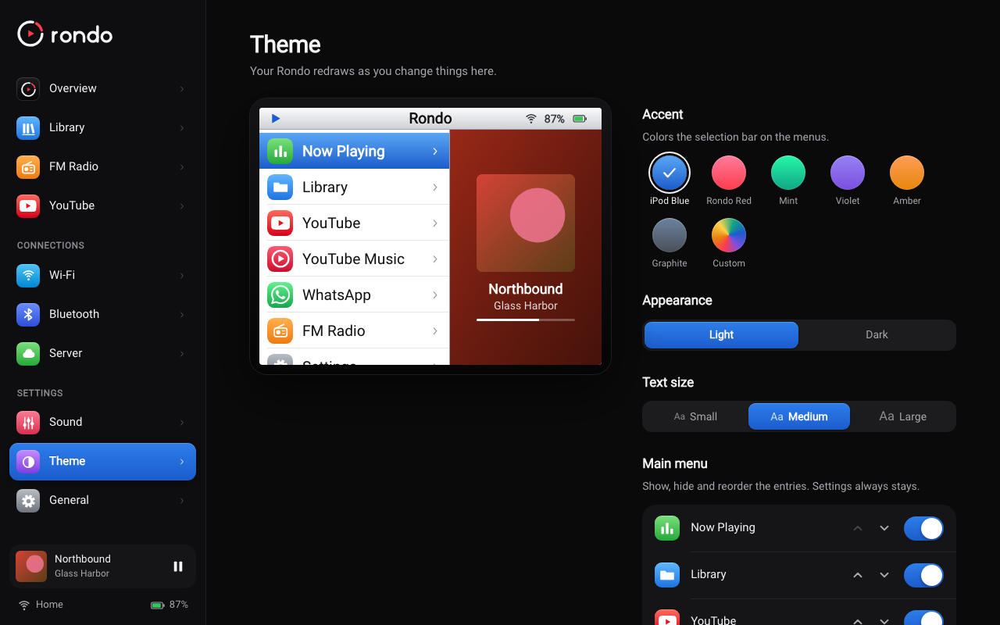
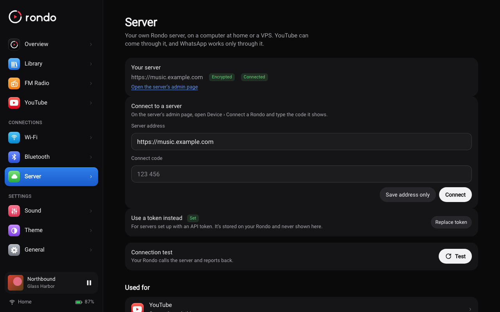

# The dashboard

The dashboard is a web page served by the Y1 itself. Use it from a phone or computer to upload
music, change settings and look after the Y1 without turning the wheel through every menu. It
needs no server, only the same Wi-Fi as the Y1 (and the internet for what comes from YouTube or
GitHub, like signing in or an update).

  
  

## Opening it

1. On the Y1, open **Settings › Dashboard**. It shows an address like `http://192.168.1.118:8080`,
   a QR code of it, and a 6-digit pairing code.
2. Open that address in a browser on the same Wi-Fi, or scan the QR code with your phone.
3. Type the pairing code.

The dashboard runs only while that screen is open on the Y1. Press Menu on the Y1 to stop it.
The pairing code changes every time. If someone types five wrong codes, the dashboard pauses
pairing for half a minute.

## Overview

What's playing, with play/pause, skip and a volume slider, the **sleep timer**, plus the battery,
how full the card
is, the Wi-Fi network with the Y1's IP and MAC addresses, where YouTube comes from (directly or
your server) and the time zone, and Rondo's version, with **Restart** and **Shut down** buttons.

Your browser checks GitHub for a newer Rondo (the update page's site). When one is out, a row
says so, with **Install**: the browser downloads the update and sends it to the Y1, which installs
it and restarts with everything kept (the dashboard stops with it). **Update from a file**, under
the Rondo row, does the same with a `rondo-<version>.rondo` you downloaded from the
[releases page](https://github.com/jarvissax/rondo/releases). A release that needs a new firmware
shows no Install button: it points to Innioasis Updater CE instead.

The sidebar has the pages in groups: **Overview**, **Library**, **FM Radio** and **YouTube**, then
**Connections** (Wi-Fi, Bluetooth, Server) and **Settings** (Sound, Theme, General). On a phone the
tabs at the bottom are Overview, Library, Radio, YouTube, Podcasts and **Settings**, which lists the
rest.

## Library

Everything on the card, in five parts as on the Y1: **Music** (songs, albums and playlists),
**Videos**, **Audiobooks**, **Photos** and **Files**. Music has search, **Shuffle**, and sorting by title, artist,
album, album artist, genre, year or date added, and by what you listen to: most played, recently
played and rating. Albums are a Cover Flow: arrow keys, the mouse wheel or a drag move through the
covers, and the album's songs are listed below. A song's details show its tags and plays, with
stars to rate it.

- **Upload** music, videos and photos straight onto the card, several at a time: music goes to
  Music, videos to Videos, photos to Pictures; **Organize** then puts them where Jellyfin expects
  them. Expect about 3 MB a second over the Y1's Wi-Fi.
- **Play** a song on the Y1, or **delete** it.
- **Audiobooks:** the books on the card, **Continue listening** first, each with its time left and
  progress. Open one for **Resume** or **Start again**, its **speed**, **Mark as finished**, its
  chapters (click one to play from it) and bookmarks (play from one, or delete it). **Upload book
  files** puts files into the card's `Audiobooks` folder (an `.m4b` is a book by itself); **Upload a
  book folder** copies a whole folder in, so its files are one book. While a book plays, the
  Overview shows its chapter and time left, with its speed, **Add bookmark** and **Back to your
  music**.
- **Rescan** after copying files onto the card some other way.
- **Photos:** every picture on the card by folder; click one to see it large, with the arrow keys,
  a slideshow (Space) and Download.
- **Files:** the card as it is, folder by folder (and the internal storage). Make folders, rename,
  move and delete files and folders, several at once with their checkboxes, upload into the folder
  you're in (pictures, lyrics and subtitles too) and download a file to your computer. Songs and
  videos keep their plays, ratings and playlists when they move, and a moved folder takes them all.
- **Organize:** every file into the folders Jellyfin expects (as **Library › Organize the card** on
  the Y1), with the full list of moves to look through first; nothing moves until you press
  **Organize**. Shows go to `Videos/Shows/Silo (2023-)/Season 01/` and movies to
  `Videos/Movies/Arrival (2016)/`. When a show's or a movie's name doesn't say its years,
  **Look up their years** asks TVmaze (shows) and Wikidata (movies) and lets you pick the right one
  for each; a show still running is `(2023-)`, one that has ended `(2010-2022)`. The folders keep
  the years from then on.
- **Fill in** (the dashboard only): what your songs' tags leave out, looked up online and saved into
  the songs themselves, where Rondo, Jellyfin and any other player find them. Only what's missing is
  filled in, nothing is replaced.
  - **Song details:** a missing genre, year, album or track number, album by album from the iTunes
    Store (in English, from the stores of your browser's languages, the songs' own and the US one),
    then MusicBrainz. You see what was found for each album and untick any that look wrong before
    anything is saved. About three seconds an album.
  - **Lyrics:** LRCLIB's, timed where it has them, for every song that has none: saved into the
    song (FLAC, MP3, M4A), or as an `.lrc` beside a song whose kind can't hold them.
  - It runs on the Y1: close the page and come back to see how far it got. Details are saved into
    FLAC, MP3 (ID3v2) and MP4/M4A files; Ogg, WMA and the other kinds keep theirs as they are.
- **Playlists:** make, rename and delete playlists of songs on the card, add songs (from the
  playlist, or **Add to playlist** in a song's details), put them in order and play them on the Y1.
  They're the same playlists as in the Y1's Library: `.m3u8` files in the card's `Playlists` folder.
- **Smart playlists:** songs picked by rules instead of by hand: a title, artist, album, album
  artist, genre or folder that is, contains or starts with something; a year, rating, play count or
  length at least or at most a number; added or last played in the last so many days. Match all
  rules or any, choose the order (random, by artist, most played, best rated…) and a limit. The Y1
  works the songs out whenever you open one, so it follows what you add, play and rate; it lists
  them under **Library › Playlists**. They're `.smart.json` files beside the playlists.

## Podcasts

The Y1's [Podcasts](using.md#podcasts) (shows from their feeds) first, then YouTube Music's.

**Shows from their feeds**, played on the Y1: **search** for a show by its name (Apple's directory,
and Podcast Index's with a key); **Top shows** in your country, by category; **Continue listening**,
**Episodes up next**, **New episodes** (**Look now** looks for more), **your shows** with how many new
episodes each has, **Save for later** and what's **downloaded**. A show's page has **Subscribe**, its
**speed**, **Download new episodes** (on Wi-Fi: keep the latest 1 to 10, and delete played ones if
you like) and its episodes, newest first or a story's first first. An episode's **⋯** menu plays it
on the Y1 (or from the start, or a video episode's sound alone), puts it in Episodes up next,
downloads it (or deletes the download), saves it for later, marks it played, shows its notes and
opens its show.

- **Add by address** subscribes to a show by its feed's address: the one a private or paid show
  gives you. The Y1 reads it itself; it goes to no server or directory.
- **Import OPML** brings your shows from another podcast app (most can export an OPML file), one by
  one, with how many came, were already here or couldn't be read. **Export OPML** saves yours.
- **Country** chooses whose directory and charts search and Top shows use (the United States unless
  you choose another), as Podcasts › Podcast settings on the Y1 does.
- **More shows in search:** without a Rondo server, paste a free
  [Podcast Index](https://api.podcastindex.org/signup) key and secret here, and search finds shows
  there as well as in Apple's directory. They stay on the Y1 and aren't shown again. With a server,
  its own key (on its admin page) is used.

**YouTube Music's podcasts**, played on the Y1 (as its YouTube Music › Podcasts): **search** for a show or
an episode; **Continue listening** and **Episodes up next** (take one off with ×); **Episodes for
Later** and **New episodes**; what's **downloaded** on the card; and **your shows**. A show's page has
**Save to library**, its **speed** (every episode of the show plays at it) and its episodes, newest
first (**Show more** for older ones). Each episode shows where the Y1 has it; its **⋯** menu plays it
on the Y1 (or from the start), puts it next or at the end of Episodes up next, downloads it to the
card (or deletes the download), marks it played or unplayed (YouTube Music on your phone follows),
saves it for later or takes it out, and opens its show.

## Theme

The Y1 redraws while you change things here.

- **Accent:** the color of the selection bar, from a few presets or any color you pick.
- **Appearance:** light or dark menus.
- **Text size:** small, medium or large.
- **Main menu:** show, hide and reorder the entries. Settings is always there.

## General

The same settings as on the Y1 (see [Using Rondo](using.md#settings)): brightness, screen
timeout, lyrics, wheel acceleration, wheel vibration and the click sound. The Theme page above
matches the Y1's **Settings › Display › Theme**, and video quality is on the YouTube page.

**Subtitles**, as the Y1's Settings › Display › Subtitles: on or off, the language looked for first,
size, text color and opacity, background color and opacity, and edges, with a preview that changes as
you pick; **Use YouTube's look** goes back to YouTube's own.

**Language**, as the Y1's Settings › Language: the dashboard speaks the Y1's language, and changing it
here changes both (the page loads again in it).

**Date & time**, as on the Y1: the time and the time zone each set automatically or by hand, and
24-hour time. By hand, set the date and the time (or take your computer's) and pick the time zone.

## Sound

The Y1's **Settings › Sound**. Each output keeps its own sound: pick the speaker, wired headphones
or a Bluetooth device (the one music plays on now is marked), then:

- **Equalizer:** a preset, or ten bands you drag yourself; the sound follows as you drag. **Save as
  a preset** keeps your bands for every output; **Flat** sets them back.
- **Headphone match:** find your headphone model in AutoEq's measurements and Rondo corrects its
  sound. This one needs a [server](server.md), which looks the model up.
- **Loudness boost:** louder, the peaks held and never clipped.

For every output: **volume leveling**, the Y1's **amplifier**, and the **volume limit**, the loudest
step the wheel and the dashboard can set.

## Wi-Fi

The network the Y1 is on, your saved networks and the ones nearby. Join a network with its
password, forget one, or refresh the list. Typing a password here is much quicker than on the
wheel.

## Bluetooth

Turn Bluetooth on or off, search for headphones and speakers, pair and connect them, and forget
devices you no longer use. Put the headphones in pairing mode before you search.

## FM Radio

What the radio is playing, with the station name and signal strength, and controls to tune,
seek up and down, scan the whole band, change the volume, mute, and switch between headphones
and the speaker. You can also name, reorder and delete saved stations, save the ones a scan
found, and set the region. Wired headphones must be plugged into the Y1, because they're the
antenna.

## Server

Your [Rondo server](server.md), set up apart from YouTube, because more than YouTube uses it. The
Y1's own **Settings › Server** does the same on the Y1.

- **Your server:** its address, whether the connection is encrypted, whether the Y1 is connected,
  and a link to its admin page.
- **Connect to a server:** enter the server's address and the code from its admin page
  (**Device › Connect a Rondo**), then press **Connect**. YouTube's own choice stays as it is.
- **Use a token instead:** only for servers started with an `API_TOKEN` setting. Servers set up
  as in the server guide don't need it.
- **Connection test:** the Y1 calls the server and reports how long it took, the server's version,
  whether yt-dlp is ready and whether an account is connected.
- **Used for:** YouTube (through the server, or directly, as chosen on the YouTube page) and
  WhatsApp, which works only through the server and is linked on the server's admin page, not
  here.

## YouTube

Where YouTube Music and YouTube come from: **Directly to YouTube** (nothing to set up, and what
a Rondo without a server uses) or **My server**, the [Rondo server](server.md) connected on the
Server page (the choice is there once one is). The Y1's own **Settings › YouTube › Connect to**
does the same on the Y1.

- **YouTube account** (directly to YouTube): **Sign in with a code**, as a smart TV does: **Get a
  code**, open google.com/device, enter the code and allow access; the page updates by itself.
  That brings YouTube's home, Subscriptions and History, and YouTube Music's playlists and Liked
  Music. The Y1 can do the same itself (Settings › YouTube › YouTube account). Through your
  server, the server's own account counts: sign it in on its admin page.
- **YouTube Music home and history** (optional, directly to YouTube): a **cookies.txt** from a
  browser. Open a private window, sign in at youtube.com, export the cookies with a cookies.txt
  browser extension, close the window at once, then **Upload cookies.txt** here. The page says who
  is signed in. The file stays on your Rondo (only its youtube.com lines are sent) and is never
  shown; **Sign out** deletes it. A separate Google account for your Rondo is the safest choice.
  With it, YouTube Music has your own home and history too.
- **Video quality:** Auto (up to 360p, which plays smoothest), or a fixed height.

**Downloads:** paste a YouTube link (or a video id), pick 720p, 480p or 360p and press
**Download**: your Rondo saves it to `Videos/YouTube` on its card with its subtitles. Choose **Song**
(a YouTube Music link picks it by itself) to save a song instead, to `Music/YouTube Music` with its
details, cover and lyrics, or **Playlist** (a playlist's link picks it by itself) to save all of a
YouTube Music playlist's songs and a playlist of them in Library › Playlists, in YouTube's order.
**Pause all** / **Resume all** is over the list; then come the downloaded playlists (**Update** gets
their new songs; the bin deletes one, with its songs or without), each download on its way
(**Pause**, **Resume**, the cross cancels it), then the videos and songs on the card (**Save** to
your computer, or the bin to delete one). A paused download keeps what it has and goes on from
there, after a restart too. The Y1 has the same lists in YouTube › Home › Downloads and YouTube
Music › Home › Downloads. In Library › Playlists, a downloaded playlist is marked YouTube Music: it
plays and shuffles, **Update download** brings it up to date, and it isn't edited there.

## For developers

The dashboard's API is documented in [docs/dev/dashboard-api.md](dev/dashboard-api.md). To work
on the page without a Y1, run the mock in `tools/dashboard-mock` (see
[Building Rondo](building.md#working-on-the-dashboard-or-admin-page)).
