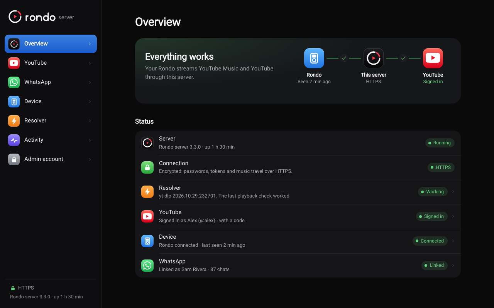
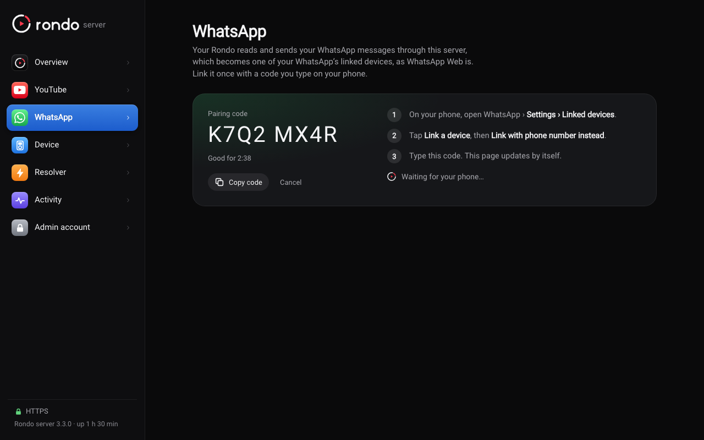

# Setting up a Rondo server

**You don't need a server for YouTube.** Rondo talks to YouTube Music and YouTube itself, straight
from the Y1 (**Directly to YouTube**, what a Rondo without a server uses), and the card, the radio,
the dashboard and updates never needed one. A Rondo server is a small service you run yourself, at
home or on a VPS. With it:

- **WhatsApp** on the Y1 (server 3.3.0 or newer). The server is one of your WhatsApp's linked
  devices, like WhatsApp Web, and keeps your chats, photos, videos and voice messages for the Y1.
  You link it on its admin page; see [WhatsApp](#whatsapp).
- **YouTube without the Y1 talking to Google**, if you choose **Through my server** in **Settings ›
  YouTube › Connect to**. The server browses YouTube for it and passes the audio and video through,
  so YouTube sees the server, not the Y1. yt-dlp finds the streams, keeping up with YouTube's
  changes (the server updates it every day), and the server has its own YouTube account, signed in
  on its admin page.
- **Headphone match** (Settings › Sound) looks up your headphone model's correction through it.

The server is set up apart from YouTube: **Settings › Server** on the Y1 (and the dashboard's
**Server** page) connects it, and YouTube uses it only when you choose it there.

Rondo 1.0 needed a server for YouTube; Rondo 2.0 doesn't. Nothing goes through anyone else's
computer either way.

One server serves one Y1. It needs [Docker](https://docs.docker.com/get-docker/) with Compose,
about 1 GB of disk, and has to stay on while you listen.

It runs on regular PCs and servers (x86-64) and on 64-bit ARM, such as a Raspberry Pi 4 or 5 with
the 64-bit Raspberry Pi OS, or most NAS boxes. 32-bit systems don't work, because the tools it
uses to reach YouTube aren't made for them. So far it has been tested on x86-64 only.

## Where to run it

| | At home | On a VPS |
| --- | --- | --- |
| Runs on | a computer, NAS or Raspberry Pi on your Wi-Fi (see below) | a rented server, with a domain name |
| The Y1 can use it | on your home Wi-Fi | anywhere it has Wi-Fi |
| Address | `http://192.168.1.10:3000` | `https://music.example.com` |
| Compose file | `infra/compose.home.yaml` | `infra/compose.vps.yaml` |

At home is simplest. Pick a VPS if you want the Y1 to use your server away from home too. (Away
from a home server, you can switch the Y1 to **Directly to YouTube**.)

## At home

Install Docker, then in a terminal:

```bash
git clone https://github.com/jarvissax/rondo.git
cd rondo
docker compose -f infra/compose.home.yaml up -d
```

Docker downloads the ready-made server (for regular PCs and 64-bit ARM like a Raspberry Pi 4 or 5)
and starts it, with a small companion that installs its updates later. When it's running, get the
one-time setup code:

```bash
docker logs rondo | grep "Rondo setup"
```

You'll also need this computer's address on your network (something like `192.168.1.10`). Give it
a fixed address in your router's settings, often called a "DHCP reservation". Otherwise it can
change one day and the Y1 loses the server.

Your server's address is `http://<that address>:3000`. Carry on with [Finish the
setup](#finish-the-setup).

## On a VPS

You need:

- a VPS with Docker; a small one is enough,
- a domain or subdomain whose DNS `A` record points at the VPS (for example
  `music.example.com`),
- ports 80 and 443 free on the VPS.

```bash
git clone https://github.com/jarvissax/rondo.git
cd rondo
echo "RONDO_DOMAIN=music.example.com" > infra/.env
docker compose -f infra/compose.vps.yaml up -d
docker logs rondo | grep "Rondo setup"
```

This starts the server and [Caddy](https://caddyserver.com) in front of it. Caddy gets a
certificate from Let's Encrypt and speaks the older kind of HTTPS that Android 4.2 still
understands (see the comments in `infra/Caddyfile`). You can check that from any computer:

```bash
openssl s_client -connect music.example.com:443 -tls1_2 -cipher ECDHE-RSA-AES128-SHA </dev/null
```

It should print a certificate chain and `Verify return code: 0 (ok)`.

Two things that break the Y1's connection:

- **Cloudflare's proxy.** If your DNS is on Cloudflare, set the record to "DNS only" (gray cloud).
  Cloudflare's HTTPS doesn't offer what Android 4.2 needs.
- **Another web server's defaults.** If the VPS already runs Caddy or nginx on 80/443, use
  `compose.home.yaml` behind it instead, and give your site the `tls` settings from
  `infra/Caddyfile`. For nginx, allow TLS 1.2 with `ECDHE-RSA-AES128-SHA` and use an RSA
  certificate.

Your server's address is `https://music.example.com`.

## Finish the setup

1. **Admin page:** open `<your server's address>/admin` in a browser. Enter the setup code from
   the log and choose an admin password.
2. **Connect the Y1:** on the admin page, go to **Device** and press **Connect a Rondo**. It shows
   a 6-digit code, good for 10 minutes.
3. On the Y1, open **Settings › Server › Connect to a server**. Type your server's address and, on
   the next screen, the code from step 2. (Typing is quicker in the dashboard: open **Settings ›
   Dashboard** on the Y1, the address it shows on your phone or computer, then its **Server**
   page.)

**Settings › Server** on the Y1 now shows your server's address; **Connection test** checks it.
YouTube Music and YouTube go through your server when **Settings › YouTube › Connect to** says
**Through my server** (a Y1 that never chose goes through it); **Directly to YouTube** there goes
back to YouTube itself, and the server stays connected, for WhatsApp and for when you switch back.

## The admin page

<p align="center"></p>

Open `<your server's address>/admin` any time to see how things are going. A sign-in lasts 12
hours.

- **Overview:** whether everything works, from the Y1 through the server to YouTube, and what
  to do when something doesn't.
- **YouTube:** the server's YouTube account: sign in with a code, add or replace cookies.txt, or
  sign out.
- **WhatsApp:** link your WhatsApp, see whose it is and how many chats came over, or unlink it.
- **Device:** the connected Y1, when it was last seen, and buttons to connect a different one or
  disconnect it.
- **Resolver:** the yt-dlp version, **Update now**, and **Test playback**, which checks that a
  video can be found the way the Y1 would ask for it.
- **Updates:** the Overview says when a newer server or yt-dlp is out. The server checks GitHub
  every 6 hours: the server's own releases (`server-v<version>`) and yt-dlp's nightly builds.
  `UPDATE_CHECK=0` in its environment turns that off.
- **Activity:** the last 100 warnings and errors, newest first.
- **Admin account:** change the password or sign out.

## WhatsApp

<p align="center"></p>

The server becomes one of your WhatsApp's linked devices, as WhatsApp Web is, and the Y1 reads and
sends through it ([using it on the Y1](using.md#whatsapp)). To link it:

1. On the admin page, open **WhatsApp**, type your WhatsApp number with its country code and press
   **Get a code**. An 8-character code shows, good for about two and a half minutes.
2. On your phone, open WhatsApp › **Settings › Linked devices**, tap **Link a device**, then **Link
   with phone number instead**, and type the code.

The page then says **Linked** with your name, and your recent chats come over in a minute or two
(WhatsApp gives a new linked device the recent ones, not your whole history). Your phone lists the
server under Linked devices as Chrome (Mac OS). **Unlink** on the admin page, or removing it on your
phone, ends it; unlinking deletes the chats and media the server kept.

- **What the server keeps:** your chats, contacts and messages in a small database, and the photos,
  videos and voice messages as they arrive (so the Y1 can show them even when WhatsApp no longer
  would), all on its Docker volume. Videos the Y1 can't play as they are are converted once for it.
- **It never shows you as online** and sends no notifications, so your phone keeps its own. A chat
  opened on the Y1 is marked read.
- **WhatsApp's terms don't allow unofficial apps** like this one (it uses
  [Baileys](https://github.com/WhiskeySockets/Baileys)), and WhatsApp may close accounts that use
  them.

## Your YouTube account (optional)

This is the server's own account, which a Y1 going **Through my server** uses. (Directly to YouTube, the Y1
signs in by itself: Settings › YouTube › YouTube account, or the dashboard's YouTube page.)

Without an account you can still search and play anything, open artists, albums and public
playlists, and see a general home page. Rondo hides Library, Subscriptions and History until an
account is connected.

| | No account | Sign in with a code | Plus cookies.txt |
| --- | --- | --- | --- |
| Search, play, artists, albums, public playlists | yes | yes | yes |
| YouTube home | general | yours | yours |
| YouTube subscriptions and history | hidden | yes | yes |
| YouTube Music playlists and liked songs | hidden | yes | yes |
| YouTube Music home and history | general | general | yours |

**Sign in with a code** works like signing in a smart TV. On the admin page, go to **YouTube
account** and press **Get a code**. Open google.com/device on your phone, enter the code and allow
access. It renews itself and keeps working when you use the same account in a browser. **Sign
out** on the admin page undoes it, at Google too.

**cookies.txt** adds YouTube Music's own home and history. YouTube only gives those to a browser
session:

1. Open a **private window** and sign in at youtube.com. A separate Google account for Rondo is
   the safest choice, because YouTube sometimes flags accounts used by servers.
2. Export the cookies with a "cookies.txt" browser extension (Netscape format).
3. **Close the private window right away.** If the browser keeps using that session, Google
   replaces it and the server gets signed out.
4. On the admin page, press **Upload cookies.txt**. It says who's signed in when it worked, and
   **Activity** warns you if the cookies stop working later.

## Keeping it running

- **yt-dlp updates itself** every day. When YouTube changes something and playback stops, press
  **Update now** on the admin page's **Resolver** page.
- **Updating the server:** when a newer server is out, the admin page's Overview says so. Press
  **Update**: the server downloads the new version and restarts on it, in a minute or two. Your
  admin password, account and connected Y1 stay; sign in to the admin page again afterwards. This
  is the job of the `rondo-updater` container next to the server, which needs Docker's socket and
  only ever touches the `rondo` container. If you'd rather update by hand:

  ```bash
  cd rondo
  git pull
  docker compose -f infra/compose.home.yaml pull           # or compose.vps.yaml
  docker compose -f infra/compose.home.yaml up -d
  ```

  A server set up before 1.0.2 built itself and has no updater yet; those four lines move it to the
  ready-made images, with **Update** from then on. Your admin password, account and connected Y1
  are kept on a Docker volume and survive updates either way.
- **Updating the Y1:** Rondo 2.0 checks GitHub for its own updates, server or not
  (**Settings › System › Software update**, see [Updating Rondo](install.md#updating-rondo)). The
  server still hands a Rondo 1.0 its updates, and tells it when a release needs a new firmware, as
  2.0 does: it fetches them from Rondo's update page and passes them on.
- **The server and Rondo have versions of their own** (since server 3.1.0 and Rondo 3.0.2): most
  Rondo releases change only the Y1, and the server needs updating only when there's a server release.
  When a Rondo needs a newer server, it says **Server needs an update** in **Settings › Server**
  and in the dashboard's server test. WhatsApp needs server 3.3.0 or newer; the Y1's WhatsApp says
  so with an older one.
- **One Y1 per server.** Connecting another Rondo disconnects the previous one.
- **Forgot the admin password?** Remove it and restart. The server prints a new setup code, and
  your Y1 stays connected:

  ```bash
  docker exec rondo node -e 'const f="/data/config.json",fs=require("fs"),d=JSON.parse(fs.readFileSync(f));delete d.adminHash;fs.writeFileSync(f,JSON.stringify(d,null,2))'
  docker restart rondo
  docker logs rondo | grep "Rondo setup"
  ```

## Privacy

The server doesn't store YouTube's audio or video; it passes streams through as they play. (A
video you download is saved on the Y1's card, not on the server.) WhatsApp is different: the server
keeps your chats and the photos, videos and voice messages they hold, so the Y1 can show them;
unlinking deletes them. Your cookies, the code sign-in and WhatsApp's link stay on the server's
Docker volume, readable only by the server, and are never shown or written to the logs (neither is
your WhatsApp number). Going **Through my server**, the Y1 reaches YouTube only through your server,
never Google directly. It still checks GitHub for Rondo's own updates.

With a server, Rondo sets its time zone from it: once each time the Y1 joins Wi-Fi, the server asks
[ipwho.is](https://ipwho.is) (or, if that fails, [ipapi.co](https://ipapi.co)) which time zone the
Y1's public IP address is in. Only that address is sent; a Y1 on the same network as the server is
looked up by the server's own address. Answers are kept for 12 hours. Until a zone is named, the
Y1 uses UTC. Directly to YouTube, the Y1 asks the same two services itself. Either way, **Settings ›
System › Date & time** can set the time zone by hand instead.

How the server works, and its API, are described in [docs/dev/server-api.md](dev/server-api.md).
